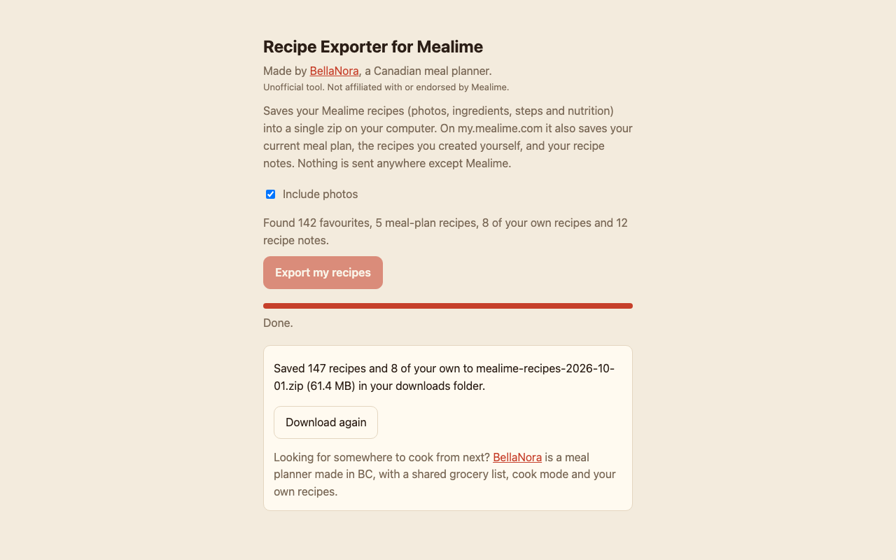
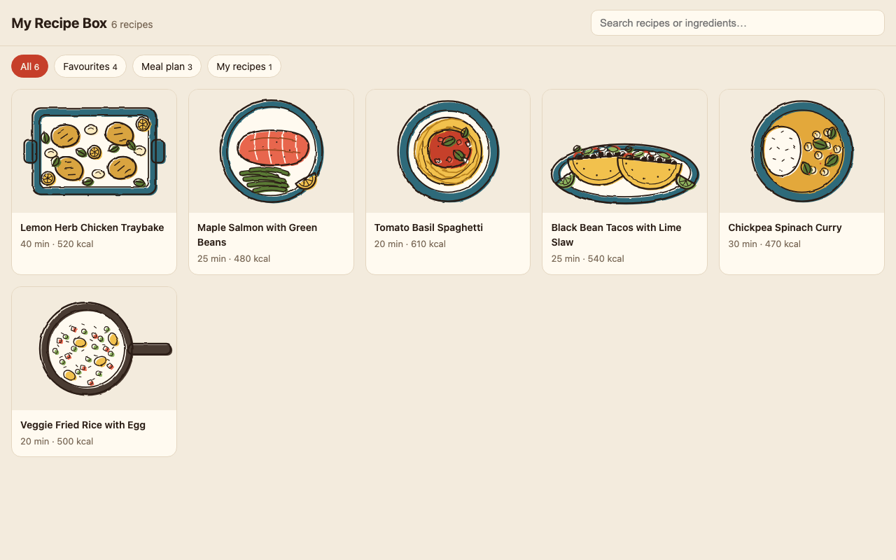

# Recipe Exporter for Mealime (unofficial)

Mealime shuts down on **October 21, 2026**, and your recipes go with it. This free Chrome extension saves a copy of your own Mealime recipes to your computer first: favourites, your meal plan, recipes you created, and your recipe notes. You get one zip with an offline cookbook you can open in any browser.

Made by [BellaNora](https://bellanora.ca/?utm_source=github), a Canadian meal planner. Not affiliated with, endorsed by, or supported by Mealime.



| | app.mealime.com (older app) | my.mealime.com (newer app) |
|---|---|---|
| Favourites (full recipe, photo, nutrition) | ✓ | ✓ |
| Current + previous meal-plan recipes | | ✓ |
| Recipes you created yourself | | ✓ |
| Your recipe notes | | ✓ |

## Install (about 2 minutes)

The extension is waiting for Chrome Web Store review. Until then, you can install it straight from here. It works in Chrome, Edge, Brave and other Chromium browsers on a computer (not on phones).

1. **Download** [recipe-exporter-for-mealime.zip](https://github.com/ianknauer/mealime-recipe-exporter/releases/latest/download/recipe-exporter-for-mealime.zip) and **unzip it**. Double-clicking it on a Mac or choosing *Extract All* on Windows gives you a folder. Keep that folder somewhere you won't delete it until you're done.
2. In Chrome, go to **`chrome://extensions`** (type it in the address bar).
3. Turn on **Developer mode** (the switch at the top right).
4. Click **Load unpacked** and choose the unzipped folder. "Recipe Exporter for Mealime" appears in the list.
5. Click the puzzle-piece icon in Chrome's toolbar and pin the exporter so its icon is easy to find.

Chrome may warn you about developer-mode extensions now and then. That's normal for anything installed this way.

## Export your recipes

1. Go to **[my.mealime.com](https://my.mealime.com)** (or app.mealime.com) and log in.
2. **From that tab**, click the exporter's icon. The export page opens beside it and shows what it found.
3. Click **Export my recipes**. It takes about a minute for 150 recipes. The zip lands in your downloads folder.
4. Unzip it and open **`index.html`** to browse your recipes offline.



## Privacy

Everything happens in your browser. The extension only talks to Mealime, only when you click Export, and keeps nothing afterwards. No analytics, no tracking, no server. Your Mealime login token is used inside the Mealime tab and is never stored or written into the export. The code is all here to check. Full policy: <https://bellanora.ca/recipe-exporter/privacy>.

## Remove it

Once you have your zip, go to `chrome://extensions`, click **Remove** on the exporter, and turn Developer mode back off. Your zip stays where it is.

## For developers

### What's in the zip

```
mealime-recipes/
  index.html       offline, searchable cookbook (filters for Favourites / Meal plan / My recipes on my.mealime.com)
  recipes.json     normalised data (schema_version 1) – build your own app on this
  schema-org/      one schema.org Recipe per file – importable by Mealie, Tandoor, Paprika…
  markdown/        one .md per recipe
  images/          one photo per recipe
  raw/             recipe data as Mealime returned it (account details removed)
  README.txt       includes any recipes/photos that couldn't be downloaded
```

#### recipes.json

Top level: `schema_version`, `exported_at`, `source`, `exporter`, `count`, `nutrition_basis`, `nutrition_units`, `recipes[]`.
my.mealime.com exports also have `collections` (`favourites` / `meal_plan` slug lists), `custom_recipes_count`, `custom_recipes[]`, and `unmatched_notes` (notes on recipes that weren't exported, keyed by Mealime recipe id). These keys are absent from app.mealime.com exports.

`recipes[]` and `custom_recipes[]` share one shape:

| field | type | notes |
|---|---|---|
| `id` | number | Mealime recipe id (`recipe_id`); custom recipes have `uid` instead |
| `name`, `slug` | string | slug is unique across the whole export |
| `servings`, `cook_minutes` | number \| null | custom recipes have no cook time |
| `image` | string \| null | relative path; null if there's no photo or it failed |
| `source_image_url` | string \| null | original CDN URL (stops working after the shutdown) |
| `cookware` | string[] | empty for custom recipes |
| `ingredients` | `{quantity, name}[]` | `quantity` is one string incl. unit and unicode fractions, e.g. `"½ (227 g) block"`; may be `""`. Custom recipes are free text in `name` |
| `steps` | `{text, uses: string[]}[]` | `uses` = amounts consumed in that step; custom recipes' body is split on new lines |
| `nutrition_per_serving` | object \| null | ~66 nutrients; null for custom recipes |
| `note` | string | only present when you wrote a note for that recipe |
| `import_url` | string \| null | custom recipes only |

### How it works

The icon opens `export.html?tab=<id>`, bound to the tab you clicked from. That tab must be on one of the two Mealime sites.

**app.mealime.com.** Runs `fetch('/api/favourites')` inside your tab via `chrome.scripting.executeScript`, using the cookie session you're already logged in with. Full recipes come back inline.

**my.mealime.com.** Inside your tab (the extension's isolated world), reads the site's login token from `localStorage.mealimeAuthToken` and calls `POST https://api.mealime.com/api/v2/get_user` with `Authorization: Token token=…`, which is the same request the site makes. That function returns **only** favourite references, meal-plan recipes, non-deleted custom recipes and notes. The token, email and subscription details never leave the tab, and the extension doesn't need permission for `api.mealime.com`. Favourites are then fetched from the public `cdn-recipes.mealime.com/<uuid>.json` without credentials, 6 at a time, with one retry. Failures are skipped and listed in README.txt.

Photos come from `cdn-uploads.mealime.com`. The extension page can read them because it has host permission, which the Mealime page itself can't do. Favourites and meal-plan recipes are merged and deduplicated by variant id. The zip is built with JSZip (unminified, MIT/GPLv3) and saved via `chrome.downloads`.

`lib/transform.js` (mapping) and `lib/cookbook.js` (offline page) are plain functions with no browser APIs, and are unit-tested in Node.

### Develop

```sh
npm install          # only for the e2e tests (Playwright)
npm test             # unit tests
npm run test:e2e     # both sites with Mealime mocked: exports, retries, logged out, expired session,
                     # wrong site; asserts no token/email/subscription data reaches any exported file
npm run zip          # dist/recipe-exporter-for-mealime.zip for the Chrome Web Store
```

To check app.mealime.com output didn't change between versions, export with the old build and pass that folder: `node test/e2e.mjs /path/to/old-export`.
